 

   

## 👋 About me

  

## 🛠️ Tech stack

  

## 📈 GitHub activity

  

  <picture>
    <source media="(prefers-color-scheme: dark)" srcset="https://raw.githubusercontent.com/xHypnos/xHypnos/output/github-contribution-grid-snake-dark.svg" />
    <source media="(prefers-color-scheme: light)" srcset="https://raw.githubusercontent.com/xHypnos/xHypnos/output/github-contribution-grid-snake.svg" />
    
  </picture>

  

